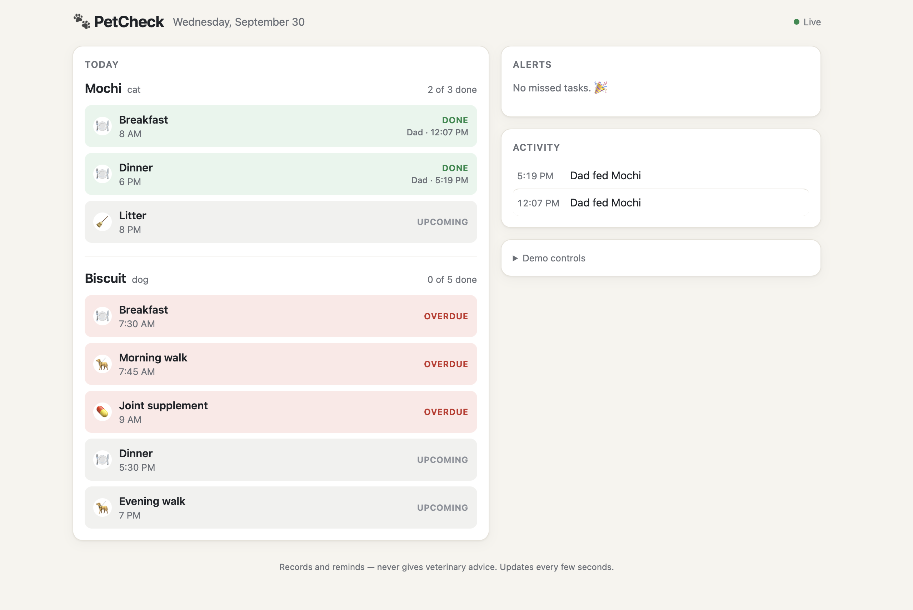
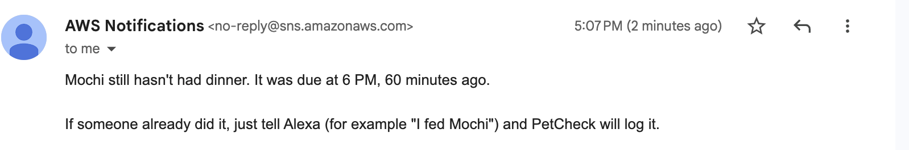

# PetCheck 🐾

**A shared pet care log for Alexa+.** Anyone in the house says "I fed Mochi," and everyone knows it's done.
When nobody at home can do it, Alexa asks pet sitters nearby.

PetCheck is an **MCP server** (spec 2025-11-25, Streamable HTTP) running on **AWS Lambda**, with
DynamoDB storage, scheduled missed-task alerts, a **care network** that matches households with nearby
pet sitters, OAuth 2.1 for Alexa+ account linking, a live household page, and a **simulated Alexa+** web
experience that talks to the server through a real MCP client and any tool-calling AI model.



*The live household page: what's done, what's overdue, the alerts PetCheck raised, a 7-day history with
streaks for each pet, one-tap "✓ Fed / Walked" logging, and who helped most this week.*

## The problem

"Has anyone fed the cat?" gets asked in pet households every day, and the answer is usually a guess.
Pets get fed twice, or they miss a meal or their medication. Hands are full (food bowl, leash, pill
pocket), so opening an app is the last thing anyone does. Voice is the natural place for this.

## What PetCheck does

| Say this | PetCheck does |
|---|---|
| "I fed Mochi" | Logs it for the whole household |
| "I fed Mochi" (Emma, 10 minutes after Dad) | "Dad already fed Mochi at 7:52 AM. Do you want me to log it again?" |
| "Has anyone walked Biscuit?" | What's done today and what's still due or overdue |
| "Mochi threw up this morning" | Records the observation; counts repeats, never interprets them |
| "Book Mochi's checkup next Tuesday at 10" | Schedules the vet visit and reminds the household the day before |
| "How's Mochi doing this week?" | Meals, walks, meds, missed tasks, notes and the next vet visit |
| *(nobody logs dinner)* | 30 min late: household reminder · 60 min late: owner gets an email |
| "We're away this weekend. Can someone walk Biscuit twice a day?" | Fills in a care request (pets, service, days, times, typical pay, location from the device), reads it back, posts it when you say yes |
| Sam, a pet sitter: "Any dog walking jobs near me this weekend? At least $20." | Nearby open requests that fit: distance, kinds of pets, days, pay, no clash with his bookings |
| Sam: "I'll take the one for Biscuit" | Books it; the household sees who's coming, and Sam's visits are logged like anyone's |

**Safety rule:** PetCheck records and reminds; it **never gives veterinary advice.** Questions about
symptoms, doses, food safety or treatment get "please check with your vet."

## Try it (about 2 minutes, no AWS account needed)

Requires Node 20+.

```bash
npm install
npm run demo
```

Then open **http://localhost:3000/demo** and enter any household key (none is set locally). The left
side is the simulated Alexa+: pick who's speaking (Mom, Dad or Emma), press the mic (Chrome or Safari)
or type, and try:

1. As **Dad**: "I fed Mochi" → logged; the household page on the right updates within seconds.
2. As **Emma**: "I fed Mochi" → "Dad already fed Mochi… log it again?"
3. On the right: **Demo controls → Pretend it's 19:00 → Show → Run missed-task check** → reminders and owner alerts appear.
4. As **Mom**: "How's Mochi doing this week?" → a summary built from a seeded week of history.

The care network needs a language model (below): as **Mom**, "We're away this Saturday and Sunday. Can someone
walk Biscuit twice a day?", then "yes"; switch to **Sam · sitter** (his phone is a few streets away) and ask
"Any dog walking jobs near me this weekend?", then "I'll take the one for Biscuit".

The **MCP traffic** panel shows every HTTP request the assistant makes to `/mcp`
(`initialize` → `tools/list` → `tools/call log_care`), with full JSON-RPC bodies.

`npm run demo` uses in-memory data and PetCheck's built-in rules engine, so it runs anywhere with no keys.
The household's pets and last week's history are sample data, seeded at startup; restarting resets them.

**Browsers:** typing works everywhere. The mic needs the Web Speech API: Chrome (which sends audio to
Google's speech service, so it needs a connection to it) or Safari. Firefox has no speech recognition, so
type there. All times are shown in the household's time zone (`HOUSEHOLD_TZ`, default America/Detroit).

**With a real language model:** copy [`.env.example`](.env.example) to `.env`, fill in an API key for any
OpenAI-compatible or Anthropic-compatible endpoint (a relay works too), then `npm run demo:ai`. The startup
line and the engine badge on the page show which model is answering. We develop against a relay (ZenMux:
Claude Opus 5.5 and Haiku 5.5, GPT-4.1 mini) and Alibaba Cloud Model Studio (Qwen); Amazon Bedrock works
the same way once an account has model access. `STORAGE=file` keeps local data and conversations in `.data/`
across restarts.

## How it works

```
 Simulated Alexa+ (/alexa)          Real Alexa+ (MCP add-on)
 browser speech in/out              OAuth 2.1 account linking
        │ text                               │
        ▼                                    │
 /api/assistant                              │
 language model picks tools                  │
 (OpenAI / Anthropic API or Bedrock)         │
 → MCP client ──── Streamable HTTP ──────────┤
                                             ▼
                        PetCheck MCP server  /mcp   (AWS Lambda, stateless)
                        10 tools · API key or OAuth bearer token
                                │
             ┌──────────────────┼────────────────────────┐
             ▼                  ▼                        ▼
      Amazon DynamoDB   EventBridge Scheduler      Household page (/)
      (single table)    every 5 min → missed-task  live view, polls /api/today
                        check → Amazon SNS email
```

- **The MCP server is always in the call chain.** The simulated Alexa+ never touches the data directly:
  its backend is an MCP client ([`src/assistant.ts`](src/assistant.ts)) that connects to `/mcp` over
  HTTPS, lists the tools and calls them, exactly as Alexa+ would.
- **Stateless Streamable HTTP.** A fresh `McpServer` and transport per request, no session IDs, JSON
  responses. Each request loads the household from DynamoDB with one Query, runs the tool, and
  batch-writes only new records, so it runs unchanged on Lambda.
- **Any tool-calling model, with a fallback.** [`src/models.ts`](src/models.ts) speaks three protocols:
  OpenAI Chat Completions, Anthropic Messages (each against any compatible endpoint) and the Amazon
  Bedrock Converse API. `ASSISTANT_ENGINE` picks one; the tool loop and the MCP calls are identical for all
  of them. In `auto` mode, if the model can't be reached (bad key, quota, outage) the assistant switches to
  a rules engine that understands PetCheck's phrases and still calls the same MCP tools, and retries the
  model after 10 minutes. The UI labels which engine and model answered every turn.
- **Conversations with memory.** The simulated Alexa+ keeps each device's conversation server-side
  ([`src/sessions.ts`](src/sessions.ts)): the last 8 turns, including tool calls and their results, so "How
  about Biscuit?", "I just gave her dinner" or a "yes" to a duplicate check have the context they need. A
  conversation ends after 30 idle minutes, like Alexa's. It's stored like everything else: in memory, in
  `.data/` (`STORAGE=file`) or in DynamoDB.
- **Storage.** `memory` (fresh sample data each start), `file` (an append-only JSON Lines file locally) or
  `dynamodb` (AWS). Records are only ever added, never updated, so concurrent devices can't overwrite each
  other; a sitter taking a job is a separate record, and the first one wins.
- **Checked against the real model.** `npm run test:live` replays 12 scenarios on fresh data at a fixed demo
  time (natural phrasing, log-and-ask in one sentence, follow-ups, a pronoun from the previous turn, "I fed
  him" with no pet named, duplicate confirm and cancel, an unknown pet, a dose question, a vet visit, posting
  a care request, a sitter finding and taking a job then logging a visit, and asking who took it), and checks
  the tool calls and the stored records, not just the wording. Claude Opus 5.5, Claude Haiku 5.5 and GPT-4.1
  mini pass all 12.

### Where the track technology runs (for reviewers)

| File | What it does at runtime |
|---|---|
| [`src/mcp.ts`](src/mcp.ts) | `McpServer` with the 10 tools (`registerTool`, zod schemas, tool annotations) |
| [`src/lambda.ts`](src/lambda.ts) | Lambda entry point: `WebStandardStreamableHTTPServerTransport` on `/mcp` |
| [`src/app.ts`](src/app.ts) / [`src/server.ts`](src/server.ts) | Local server: `StreamableHTTPServerTransport` on `/mcp` |
| [`src/assistant.ts`](src/assistant.ts) | Simulated Alexa+: MCP `Client` + `StreamableHTTPClientTransport` → `/mcp`, the tool loop |
| [`src/models.ts`](src/models.ts) | The model behind it: OpenAI- / Anthropic-compatible APIs or Bedrock Converse |
| [`src/oauth.ts`](src/oauth.ts) | OAuth 2.1 for Alexa+: client credentials (`mcp:service`) and authorization code + PKCE (`mcp:tools`) |

## MCP tools

| Tool | Purpose |
|---|---|
| `add_pet` | Add a pet and its daily routine |
| `log_care` | Log feed / walk / meds / litter / water / groom; asks before logging a duplicate within 30 min |
| `get_status` | Today's done / due / overdue tasks (read-only) |
| `add_note` | Record an observation |
| `add_vet_visit` | Schedule a vet appointment |
| `weekly_summary` | 7-day summary (read-only) |
| `post_care_request` | Turn what was said into a care request for nearby sitters; returns a draft first, posts with `confirm` |
| `find_care_requests` | For a sitter: open requests that fit (distance, services, pets, days, pay, no clashes), nearest first (read-only) |
| `accept_care_request` | For a sitter: take a request by its code; the household is told (and the owner emailed) |
| `care_request_status` | The household's requests and who took them, or a sitter's bookings (read-only) |

Details that came from real use:

- **Logs match the right task.** A log counts toward the nearest task that's already due (or due within
  the hour), so a 2:48 PM feeding with breakfast missed is a late breakfast, and a 5:30 PM feeding is the
  6 PM dinner.
- **Forgiving names.** Speech recognition hears "Mochi" as "Machi" or "Mochie", so names match within a
  small edit distance, and "the cat" or "the dog" means the household's only cat or dog. Anything further
  off gets "I don't know a pet called Monkey. I know Mochi and Biscuit" rather than a wrong log.
- **Spoken-friendly results.** Every tool returns a sentence Alexa can read as-is, plus structured content.

## Missed-task alerts

EventBridge Scheduler invokes the Lambda every 5 minutes. For each routine task still not logged:

| How late | Alert | Who hears about it |
|---|---|---|
| 30 min | household reminder | household page (and Alexa) |
| 60 min | owner alert | emailed to the owner via Amazon SNS |
| vet visit tomorrow (from 9 AM the day before) | vet reminder | household page, and emailed to the owner |

Each alert is raised once and stored in DynamoDB; logging the task marks it resolved. Tasks more than
3 hours late are skipped, which also prevents an alert flood after downtime.

Locally, `npm start` / `npm run demo` run the same check on a 5-minute timer (`CHECK_EVERY_MIN`, 0 turns it
off), so reminders appear without pressing anything; without SNS configured, the owner emails are written to
the server log instead of being sent.



## Care network: help from sitters nearby

Shared logs stop double feedings, but sometimes nobody at home can do it: a weekend away, a late shift.
PetCheck connects households with pet sitters nearby, through the same voice interface
([`src/market.ts`](src/market.ts)):

- **Posting by voice.** "We're away this Saturday and Sunday. Can someone walk Biscuit twice a day?" The model
  fills in a fixed-format request: pets, service (walk, drop-in, feeding, overnight, boarding, grooming),
  dates, times, pay. What wasn't said gets a sensible default: the usual times, the typical local rate. The
  **location comes from the device** ([`src/location.ts`](src/location.ts)): the Alexa device sends where it
  is with each request; without it, the household's address is used. Alexa reads the request back and only
  posts it after a yes. Walks for a cat, past dates, or a second request for the same days are refused with
  a reason.
- **Finding work by voice.** A sitter says what suits them ("dog walks near me this weekend, at least $20").
  PetCheck returns open requests within the distance, for those services and kinds of pets, on those days,
  paying enough and not clashing with jobs they already have, nearest first, and says how many others
  didn't fit and why.
- **Taking a job.** "I'll take the one for Biscuit." If two sitters take it at once, the first wins. The
  household gets a "Care network" alert (and the owner an email), and the request shows "Taken by Sam".
- **Accountability.** The sitter's visits are logged with the same `log_care` as the family's, so the owner
  sees them on the household page, and a missed visit raises the same reminders and alerts.
- **Privacy.** Sitters see the area and distance, never an exact address.

**Business model (plan):** free for households; a small fee on each visit booked through the care network,
paid by the household. The sample requests from other households in the demo are sample data.

## Alexa+ add-on readiness

PetCheck meets the Alexa+ MCP Toolkit requirements we could implement ourselves:

- Streamable HTTP (2025-11-25), public HTTPS URL, warm tool calls in roughly 100–200 ms
- **OAuth 2.1:** metadata at `/.well-known/oauth-authorization-server`; `client_credentials` → `mcp:service`
  (can list tools but is refused household data with 403 `insufficient_scope`); authorization code + PKCE
  S256 → `mcp:tools` for the linked household; tokens expire in ≤ 3600 s; no refresh token for client
  credentials; RFC 6749 error responses; unauthenticated requests get 401 without `WWW-Authenticate`
- Account-linking page where the owner enters the household key
- Listing materials in [`alexa/`](alexa/): icons in all 6 sizes, a 600×900 carousel image, descriptions
  and example phrases ([`alexa/listing.md`](alexa/listing.md), checked by `npm run check:listing`),
  plus [privacy policy](src/privacy.html) and [terms](src/terms.html) pages served at `/privacy` and `/terms`

**Why the demo uses a simulated Alexa+:** the Alexa+ add-on developer tools (`alexa-ai` CLI) are in private
preview and not available to hackathon participants (confirmed by Amazon's Chief Alexa Evangelist on the
hackathon Discord; our AccessDenied attempt is documented in [FRICTION_LOG.md](FRICTION_LOG.md) FL-008). As the
rules allow, the demo uses a **simulated Alexa+** web experience that calls the same deployed MCP server through
a real MCP client. Everything we could build ahead of access is done: once the toolkit opens up,
`alexa-ai new mcp --mcp-server-url <url>/mcp` plus the OAuth endpoints and the materials in `alexa/` is all that's left.

## AWS services used

| Service | How PetCheck uses it |
|---|---|
| **AWS Lambda** | Hosts the MCP server, household API, pages and OAuth endpoints behind an HTTPS Function URL |
| **Amazon DynamoDB** | Single-table storage for pets, care logs, notes, vet visits and alerts, a shared partition for the care network, and conversation sessions (free-tier capacity) |
| **Amazon EventBridge Scheduler** | Invokes the Lambda every 5 minutes for the missed-task check |
| **Amazon SNS** | Emails the owner when a task is an hour overdue |
| **Amazon Bedrock** | Optional engine for the simulated Alexa+: Converse API with tool use (Amazon Nova Lite). Our account is still waiting for access (FL-006), so the demo uses an OpenAI-compatible endpoint instead |
| **AWS IAM** | Least privilege: Lambda may only touch the `petcheck` table, the alert topic and Bedrock invoke; the scheduler may only invoke the function |

## Deploy to AWS

Requires the AWS CLI configured (`aws configure`, region `us-east-1`).

```bash
npm run db:create   # one-time: DynamoDB table
npm run db:reset    # demo data: Mochi, Biscuit and last week's history
npm run deploy      # Lambda + Function URL + 5-min schedule + OAuth secrets (+ SNS if ALERT_EMAIL is set)
```

`npm run deploy` is idempotent: the first run creates everything, later runs update the code. It prints
the URLs and runs a smoke test (health, `tools/list`, an OAuth client-credentials token, a missed-task
check). Secrets (API key, OAuth client secret and signing key) are generated once into `.env.deploy`,
which is git-ignored. Add `ALERT_EMAIL=you@example.com` there for owner emails, and the model settings
from `.env.example` (`ASSISTANT_ENGINE`, `OPENAI_*` or `ANTHROPIC_*`) to choose the simulated Alexa+'s model.

| Path | What |
|---|---|
| `/` | Household page |
| `/alexa` | Simulated Alexa+ |
| `/demo` | Split screen: simulated Alexa+ and the household page, for recording. Add `?time=17:40` to run both sides on a demo clock (also works on `/` and `/alexa`) |
| `/mcp` | MCP endpoint (household key via `x-api-key` / `Authorization: Bearer`, or an OAuth token) |
| `/api/today`, `/api/check-missed`, `/api/log`, `/api/assistant` | JSON API used by the pages |
| `/.well-known/oauth-authorization-server`, `/oauth/authorize`, `/oauth/token` | OAuth 2.1 for Alexa+ |
| `/privacy`, `/terms`, `/health` | Listing pages and a health check |

To record the demo video at any time of day: `npm run db:demo -- 17:35` resets the household as if it
were 5:35 PM, then open `/demo?time=17:40`. Locally, `npm run demo:video` does the same in memory (with the
model from `.env`). The shot list is in [docs/submission/video-script.md](docs/submission/video-script.md).

Other commands: `npm run logs` (follow the Lambda logs), `npm run db:status`, `npm run dev:dynamo`
(local server against DynamoDB), `npm run inspector` (MCP Inspector; connect with Streamable HTTP to
`http://localhost:3000/mcp`).

## Tests

```bash
npm test                # all of the offline checks below (no network, no keys)
npm run smoke           # tool logic: duplicate check, status, notes, summary, vet visits
npm run test:alerts     # missed-task alerts, vet reminders and task matching with a simulated clock
npm run test:storage    # persistence with a fake database, incl. Lambda cold starts between requests
npm run test:lambda     # the Lambda handler with Function URL events, incl. OAuth flows
npm run test:oauth      # OAuth 2.1 as Alexa+ runs it, plus negative cases
npm run test:assistant  # assistant → real MCP client → HTTP → real server; model-blocked fallback
npm run test:models     # OpenAI / Anthropic wire formats against fake model servers; when auto falls back
npm run test:rules      # the rules engine's phrase understanding
npm run test:market     # the care network: drafts, refusals, auto-location, matching, clashes, taking a job
npm run check:listing   # Alexa+ listing limits and image sizes
npm run build           # TypeScript type check of src, test and scripts

npm run check:mcp       # official MCP Inspector CLI against a local server: tools/list, a read, a write,
                        # an invalid call (add a URL to check a deployed server; set API_KEY for its key)

npm run test:live       # 12 acceptance scenarios against the real model in .env (needs a key)
```

## Demo video

The video was made with AI end to end ([`scripts/video/`](scripts/video/make-video.mjs)): the narration is
generated by a text-to-speech model and checked by transcribing it back; Playwright drives the real app
(`npm run demo:video`, the real model answering) and records the screen; Alexa's answers are read by a second
voice; ffmpeg shortens the wait while the model thinks and lines the voices up with the picture. Lines are
typed in the recording; the mic works in Chrome and Safari.

## Friction log

Eight entries, written as things happened: [FRICTION_LOG.md](FRICTION_LOG.md). Highlights: the MCP SDK's
Node transport fails behind serverless-http on Lambda (FL-005), new accounts are blocked from Bedrock
with a misleading `ValidationException` (FL-006), speech recognition mangles pet names (FL-007), and the
Alexa+ MCP Toolkit setup gives AccessDenied with no documented way to request access (FL-008).

## License

[MIT](LICENSE)
